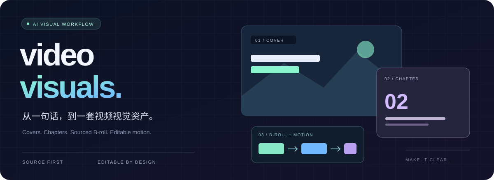
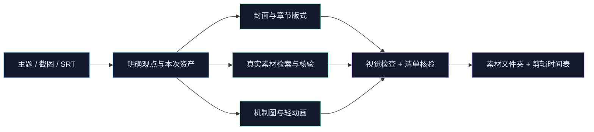

<div align="center">



<br />

**把主题、讲稿和字幕，变成能直接进入剪辑时间轴的视觉素材。**

双比例封面 · 章节卡 · 真实 B-roll · 可编辑轻动画

[](LICENSE)
[](SKILL.md)
[](#开始使用)
[](references/animation.md)

[开始使用](#开始使用) · [能力地图](#能力地图) · [工作流程](#工作流程) · [工具依赖](#工具依赖) · [维护同步](#维护同步)

</div>

---

## 让画面多解释一点

讲到一个科学家，就让观众认识这个人；讲到一个机制，就让关系一步步出现；讲到真实实验，就找到对应的实验画面。

`video-visuals` 是一套给 AI 助手使用的视频视觉工作流，适合中文科普、知识讲解和口播视频。从一句主题开始做封面，也可以沿着 SRT 字幕制作整套配图。只要封面时，就只做封面。

> **真实素材优先，重要文字可编辑，时间点有依据，交付可以续做。**

## 能力地图

| | 输入 | 交付 |
| :--- | :--- | :--- |
| **◈ 封面设计** | 主题、已定文案，或真实课堂截图 | 同一设计独立适配 **16:9 + 4:3**，PNG 与实际使用的版式源文件 |
| **▤ 章节配图** | 带时间的 SRT 字幕 | 章节 PNG、可编辑 SVG、剪辑时间表 |
| **◎ 真实 B-roll** | 字幕里的对象、实验、人物与事件 | 可用的图片／视频原文件、具体落点、来源与许可记录 |
| **↗ 轻量动画** | 机制、流程、比较、人物介绍 | 按语义分组淡入的静音 MP4、完整 PNG、SVG 与时序 JSON |
| **✓ 校对与续做** | 原始 SRT、已有资产清单 | 按需字幕勘误，继续缺失或未通过的资产 |

默认封面尺寸为 `1920 × 1080` 与 `1440 × 1080`，可由用户覆盖。生成背景的实际分辨率单独记录，不把放大输出称为原生高清。

## 开始使用

### 01 / 安装整个技能目录

在 Codex 中，将仓库克隆到技能目录：

```sh
git clone https://github.com/zzirui321-rgb/video-visuals.git ~/.codex/skills/video-visuals
```

已存在同名目录时，先保留原技能和个人配置，在另一目录核对；不要直接覆盖。也可下载仓库后，将完整目录放入支持 `SKILL.md` 的助手技能目录。跨助手兼容性尚未实测，工具能力需按环境配置。

### 02 / 告诉助手这次要做什么

**一张课堂截图 → 两个比例的封面**

```text
使用 $video-visuals，基于这张课堂截图制作封面。
主题是“为什么光能推动粒子”。
保留真实人物和黑板，输出 16:9 与 4:3；不要制作其他素材。
```

**一份字幕 → 一套配图素材**

```text
使用 $video-visuals，根据这份 SRT 制作章节卡和必要的 B-roll。
优先真实科学图片与实验视频，需要解释关系时再做机制图。
保持字幕时钟，交付原素材、可编辑源文件、来源表与剪辑时间表。
```

**一个机制 → 分步骤出现的说明动画**

```text
使用 $video-visuals，将这段机制说明做成 7 秒的全屏轻动画。
按因果顺序逐组淡入，最后至少 2 秒展示完整图，保留可编辑源文件。
```

### 03 / 延续自己的账号风格

将已确认的颜色、字体、布局和参考图记录在项目的 `账号视觉约定.md` 中。下一期沿用这些约定，再按题材调整。

公开版不包含作者的个人账号配置，也不会把某位人物、机构或资历作为通用默认值。

## 工作流程



- **画面有解释收益。** 每项 B-roll 说明它增加了什么理解，装饰性画面可以为零。
- **时间来自字幕。** 原字幕作为时钟；没有时间码的文稿先做内容方案。
- **素材可追溯。** 真实照片、实验、新闻与原帖回到原始发布页核验；下载受限的候选不计作已交付素材。
- **输出经过查看。** 封面检查原尺寸与约 200px 缩略效果；结构检查通过不等于视觉验收。

## 你会拿到什么

按本次要求交付对应资产。整套任务的文件组织示例：

```text
主题_视频图片_日期/
├── 封面_16x9.png / 封面_4x3.png
├── 00-01-03-260_章节02_标题.png
├── 00-01-23-000_Broll_机制.mp4
├── 源文件/                 SVG、静态 PNG、动画时序 JSON
├── 素材/                   真实图片与视频原文件
├── 素材来源.csv
├── 剪辑时间表.md
├── 提示词.md
└── assets.json             状态、尺寸、来源与字幕关联
```

有稳定本地字幕路径时，默认在字幕所在目录交付完整文件夹；仅封面任务只交封面相关文件。默认不制作压缩包。最终剪辑仍由你熟悉的剪辑软件完成。

<details>
<summary><strong>工具依赖 · 按需展开</strong></summary>

阅读技能与制作方案没有固定运行时要求。实际制作依赖助手提供图像生成／编辑、网页检索、下载、SVG 渲染与文件操作能力。

| 工具 / 脚本 | 用途 | 依赖 |
| :--- | :--- | :--- |
| 内置 `image_gen` | 栅格场景生成与已有图片编辑 | 助手环境提供；缺失时说明阻塞，付费替代由用户选择 |
| `scripts/check_assets.py` | 读取 SRT、检查资产清单与媒体结构 | Python 3.10+；PNG 检查需 Pillow，视频检查需 ffprobe |
| `scripts/render_svg_reveal.cjs` | 将原创分层 SVG 合成为静音动画 | Node.js、sharp、FFmpeg（含 libx264） |

脚本不会自动安装依赖。命令与结构规范见 [资产清单](references/manifest.md) 和 [轻动画](references/animation.md)。第三方服务可能有独立费用与条款。

</details>

<details>
<summary><strong>维护同步 · 个人版本 → 公开版本</strong></summary>

维护者可以继续使用本地个人技能，再将适合公开的内容导出到此仓库：

```sh
# 预览本地更新
python tools/export_public.py --source <本地技能目录>

# 导出并检查差异
python tools/export_public.py --source <本地技能目录> --write
git diff
```

导出工具使用固定文件清单，替换个人偏好入口并排除私人学习笔记。出现新文件、未处理的个人账号措辞、常见本地路径或凭据模式时会停止，交由维护者检查。

导出器不删除文件，也不会自行提交或推送。默认由维护者发起同步，审核差异后再发布；这些检查不能替代完整的敏感信息审查。README、许可证和品牌素材在公开仓库单独维护。

</details>

## 一起完善

欢迎在 [Issues](https://github.com/zzirui321-rgb/video-visuals/issues) 提供使用场景、失效步骤和脱敏复现材料，或通过 Pull Request 改进工作流。请勿提交个人字幕、账户信息或未经授权的媒体。

**MIT License** · 见 [LICENSE](LICENSE)。仅覆盖维护者有权授权的本仓库原创内容；外部媒体、字体与工具遵循各自条款。

---

<div align="center">

**让每一张画面，都帮助观众理解。**

<sub>video-visuals · Source first. Editable by design.</sub>

</div>
